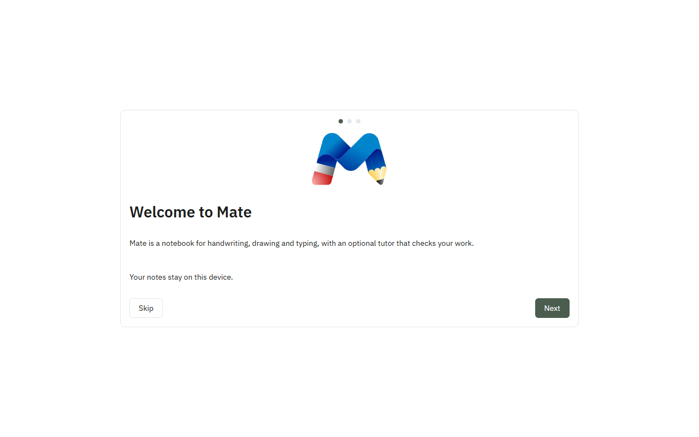
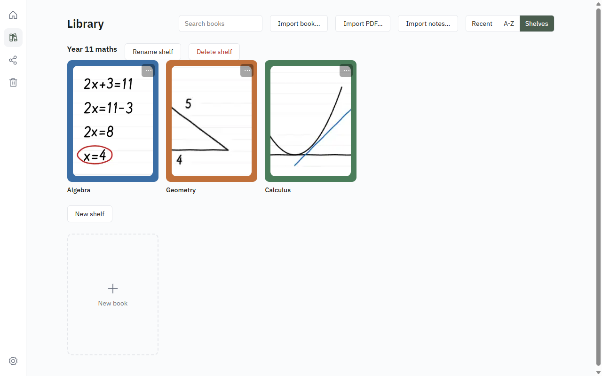
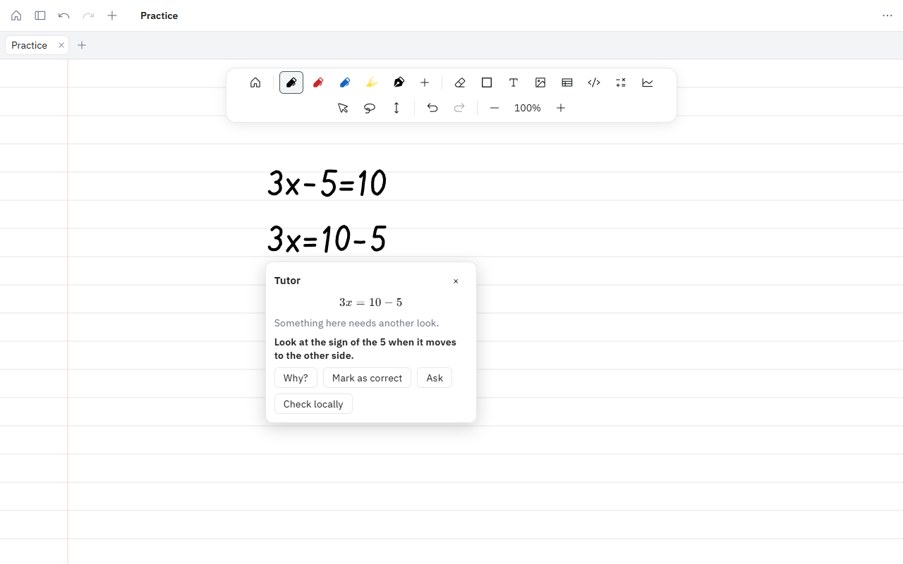
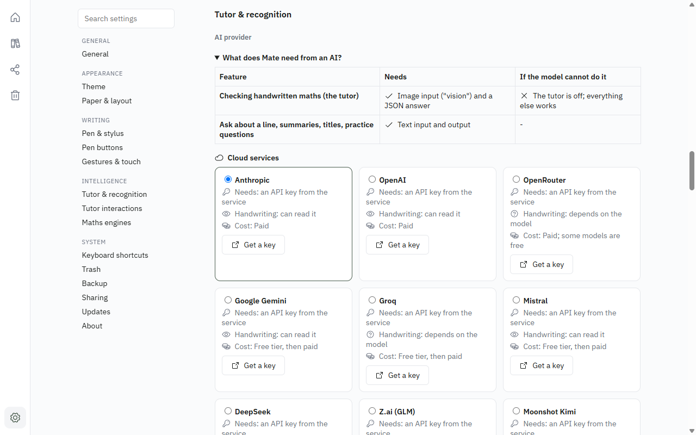
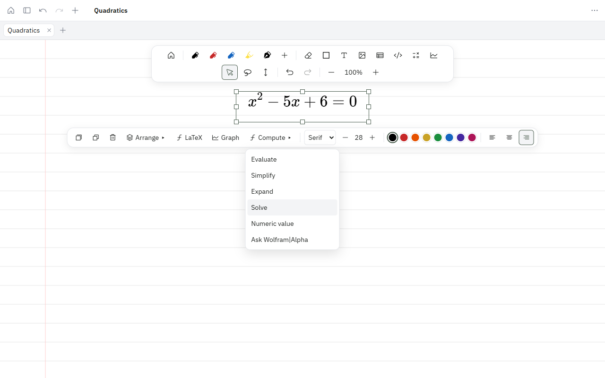

<p align="center"></p>

# Mate

Your maths mate. (In Italian, *mate* is what students call *matematica*.)

**A local-first handwriting & math notes app for Windows, macOS, Linux and Android tablets.**

Write with a pen on an endless canvas or on paged sheets, organise pages into books, sections and shelves, and keep everything on your own machine in a single SQLite file. No account, no cloud, no subscription.

Mate is built with [Tauri 2](https://tauri.app) (Rust shell + a pure-Rust core crate) and a React 19 / TypeScript frontend. The ink pipeline is tuned for low-latency pen input: pressure, tilt, palm rejection, stroke stabilisation and a snapshot-cached Canvas2D renderer.

> Status: **v0.8.0**. The app is feature-complete for its original roadmap (ink editor, rich content, an optional AI tutor, importers for GoodNotes, Notability, OneNote, Freenotes and Samsung Notes, a full settings pane, rebindable shortcuts, multi-window pages, an in-app updater). Version 0.6.0 adds many more AI providers including local models, sharing of `.mate` files, offline and Wolfram|Alpha maths engines, and a translated interface (English and Italian reviewed; the rest machine translated, still being reviewed). Version 0.7.0 brings Mate to Android tablets (see [Android](#android)). Version 0.8.0 adds finger drawing and six more paper templates. See the [roadmap](https://github.com/inalto/Mate/wiki/Roadmap) and the [release notes](src/whatsnew/0.8.0.md).

## Features

- **Ink** — pen, highlighter and fountain pen (pressure, tilt, nib flatness), toolbar presets, palettes, recent colours, stroke stabilisation, palm rejection, pen barrel/eraser-end actions
- **Canvas** — infinite canvas or paper mode (A4, Letter, 16:9, 4:3, square; ruled, grid, dot, blank, plus isometric, hex, Cornell, handwriting, columns and music templates from the **Paper** button in the editor top bar), zoom 0.1×–10×, pinch, wheel, overscroll
- **Editing** — whole/partial eraser, lasso select, move, scale, arrange, duplicate, undo/redo (100 entries / 50 MiB), keyboard shortcuts
- **Organisation** — shelves → books → sections → nestable pages; favourites; recent; trash with retention; thumbnails
- **Workspace** — sidebar (tree or split layout, left- or right-handed), tabs, split view, page settings
- **Export / import** — PNG, SVG, and `.mate` archives (a whole book, round-trippable); `.mate` files open with a double-click
- **Never lose ink** — strokes are written to SQLite 150 ms after you lift the pen; closing the window waits for pending writes and writes a recovery file if it can't; a restart-recovery card reopens the page you were on
- **Themes** — light, dark, sepia, high-contrast

## Settings

Open **Settings** from the More menu in the top bar. The pane has a list of sections on the left (General, Appearance, Writing, Intelligence, System) and a search box that jumps to a setting and briefly highlights it. Every setting has a default; the full list of keys and defaults is in the wiki: [Settings](https://github.com/inalto/Mate/wiki/Settings).

- **Appearance:** theme, invert images in dark mode, paper and layout defaults (page mode, background, page size, orientation, snap to grid).
- **Writing:** pen, highlighter, text, shape and eraser defaults; ink to shape and scribble to erase; pen barrel and eraser-end buttons; palm rejection, drawing with a finger, pinch and wheel behaviour; Pen haptics (Windows only; not yet verified on haptic pen hardware).
- **Language:** the interface language, first row of General (see Languages below).
- **Intelligence:** the AI provider, key and tutor options, and the maths engines (see below).
- **System:** keyboard shortcuts, trash retention, Sharing (Nextcloud sign-in), **Download backup** (one zip holding a `.mate` archive per book; to restore, unzip it and import each `.mate` file) and **Reset local data**, which writes a recovery zip first and then restarts (on Android the zip goes to the share sheet and Mate closes; reopen it). API keys in the system keychain (desktop) or the app's private key file (Android) are kept. Updates and About (version, Show welcome again) are here too.

## Keyboard shortcuts

Press **?** for the shortcut list, or **Ctrl+K** to search pages and run actions. Change any shortcut under Settings, Keyboard shortcuts: **Change** the keys, **Unbind**, or **Reset**; **Reset all** restores every default. A combination already used by another action is refused with that action's name. Escape, Tab and Enter cannot be bound, nor can any combination with Space (pan is held on Space), nor a bare letter or digit or a Shift-only letter. Preset slots (Alt+1 to 9), pan and clear selection are fixed. Shortcut hints on toolbar buttons follow your keys and can be always on, shown until learned, or off.

The full default table is in the wiki: [Keyboard shortcuts](https://github.com/inalto/Mate/wiki/Shortcuts).

## Windows

- **Open in new window:** from the sidebar page menu, or **Ctrl+Shift+N**. A page opens in a window of its own, without the sidebar and tabs. Opening a page that already has a window brings that window forward.
- A page window closes itself if its page is moved to the trash, and its title follows renames.
- Closing the main window closes every page window first; each one flushes its ink before it goes. If a window cannot save, the close stops and says so.

## Welcome and What's new

On first launch Mate shows a short welcome (AI setup is optional and can be skipped), with a **Playground** page to try the pen. Every step can be skipped. Show the welcome again from Settings, About. After an update, **What's new** shows that version's release notes once; they live in `src/whatsnew/<version>.md`.

## AI tutor (optional)

The AI tutor reads your handwritten maths, checks it and points out mistakes. It is **off by default** and needs an AI provider that you set up yourself: a key from a cloud service, or a model running on your own computer.

- **What it does:** underlines mistakes (and optionally ticks correct work) in each checked group of ink (ink is never changed), offers a hint, then an explanation and next steps on request, and answers questions about a line. It also summarises a page, suggests a title, finds related pages and can generate practice questions from a book.
- **Nothing is sent until you turn it on.** Mate makes no AI call until you tick the permission under Settings → Intelligence *and* set up a provider (save a key, or start the local program). Turning the permission off stops all AI calls straight away.
- **Providers:** cloud services, local programs or any compatible server, chosen under Settings → Intelligence (see [AI providers](#ai-providers) below).
- **Keys** are stored in the OS keychain (Windows Credential Manager, macOS Keychain or Linux Secret Service). They are not written to `settings.json`, not logged and never shown again after saving.
- **What is sent:** when a group of ink is checked, a PNG of that group only, plus the recognised text of up to 11 nearby lines. A question about a line sends that line's recognised text, its verdict and your question, and up to 11 nearby recognised lines, without the image. Summaries and titles send recognised page text only. Search, related pages and the graph run on your machine.
- **Turn it off:** untick the permission, switch the Tutor off under Settings → Tutor, or remove the key under Settings → Intelligence.

Details are in the wiki: [AI tutor](https://github.com/inalto/Mate/wiki/AI-Tutor).

## AI providers

Settings → Intelligence starts with a short table of what Mate needs from an AI: checking handwriting needs a model that reads images; everything else (ask, summaries, titles, practice) needs only text. Then you choose a provider:

- **Cloud services** (need an API key): Anthropic, OpenAI, OpenRouter, Google Gemini, Groq, Mistral, DeepSeek, Z.ai (GLM), Moonshot Kimi, xAI Grok and Together. Each card says whether it can read handwriting, what it costs and where to get a key. DeepSeek is text only, so choosing it turns checking off with a note.
- **On this computer** (no key): Ollama (`http://localhost:11434`) and LM Studio (`http://localhost:1234`). Your handwriting is processed on this computer and nothing is sent to the internet.
- **Custom:** any OpenAI-compatible server, by address and an optional key.

**Fetch models** lists what a provider offers, and **Test connection** checks the setup. Details, defaults and troubleshooting are in the wiki: [AI providers](https://github.com/inalto/Mate/wiki/AI-Providers).

## Languages

The interface comes in English, Italian, Spanish, French, German, Portuguese (Brazil), Japanese and Chinese (Simplified). English and Italian are complete and reviewed. The other six are machine-translated first passes and are marked as such in the picker; review by native speakers is welcome. Change it under Settings → General → Language (System follows your computer). How to fix or add a translation: [Languages](https://github.com/inalto/Mate/wiki/Languages).

## Sharing

Book menu → **Share…**. Mate can save a `.mate` copy into a Dropbox, Google Drive, OneDrive, iCloud Drive or Nextcloud folder that it finds on your computer (`<Folder>/Mate/<title>.mate`), so your sync app sends it. If you have a Nextcloud, sign in once under Settings → Sharing, and Mate can upload the book and give you a link, with an optional expiry. The password for that stays in the system keychain (desktop) or the app's private key file (Android). Double-clicking a `.mate` file imports it. Direct Google Drive, Dropbox and OneDrive APIs and OS share sheets are not built yet. See [Sharing](https://github.com/inalto/Mate/wiki/Sharing).

## Maths engines

- **Compute menu** (select a typed-maths box): Evaluate, Simplify, Expand, Solve and Numeric value, offline, using the bundled Compute Engine. The result is added as a new box under the original.
- **Check locally** on the tutor card tests whether both sides of a handwritten equation agree, with no network.
- **Wolfram|Alpha** is optional: add your own free AppID under Settings → Intelligence → Maths engines and turn the permission on, then choose Ask Wolfram|Alpha. Only that one box is sent, only when you ask.

See [Maths engines](https://github.com/inalto/Mate/wiki/Maths-Engines).

## Android

Since v0.7.0 Mate runs on Android tablets. The APK installs on Android 7.0 (API 24) and later, but it has been tested on Android 16 (API 36, emulator) only: older versions are untested, and the Android System WebView must be reasonably current. It is the same app: the library, the ink canvas, typed maths, graphs, PDFs, the AI tutor and the maths engines all work. Pages open in place instead of in their own windows, the chrome is laid out for a tablet, and notes are saved when the app goes to the background. Exports (PNG, SVG, PDF, LaTeX, `.mate`) go through the Android share sheet, and Open and Import use the system file picker.

### Touch

A finger draws by default and two fingers pan and zoom. While you use a pen, Automatic mode makes single fingers pan instead. The finger button in the toolbar cycles Automatic, Draw and Pan; Settings → Gestures & touch has the same choice as **Finger action**. Holding still at the end of a stroke straightens it or recognises a shape with a finger too.

### Install

Each release has an `.apk` for 64-bit ARM tablets. Android installs it as a sideloaded app: allow "Install unknown apps" for your browser or file manager when it asks. There is no in-app updater on Android; install the next release's APK over the old one (your notes stay, because every release APK is signed with the same key).

### Build the APK yourself

You need JDK 17, the Android SDK (command-line tools, `platforms;android-35`, `platforms;android-36`, `platforms;android-37.0`, `build-tools;35.0.1`; the app compiles against 37 and plugin libraries against 36), NDK `27.2.12479018` and the Rust targets `aarch64-linux-android armv7-linux-androideabi i686-linux-android x86_64-linux-android`. Set `JAVA_HOME`, `ANDROID_HOME` and `NDK_HOME` (see [Building and testing](https://github.com/inalto/Mate/wiki/Building-and-Testing)), then:

```bash
npm ci
npm run tauri android build -- --apk --target aarch64   # release APK under src-tauri/gen/android/app/build/outputs/apk/
npm run tauri android dev                                # debug build on a running emulator or a connected tablet
```

The Tauri CLI may add `features = []` to `tauri-build` in `src-tauri/Cargo.toml`; revert it before committing. The release APK is signed only when `src-tauri/gen/android/key.properties` exists (see "Android signing" under Updates); without it Gradle builds an unsigned APK that Android will not install until it is signed.

### Known limitations

- Files picked or opened on Android are titled by the provider's document id, not their display name.
- The Files app does not offer Mate for `.mate` files (Android reports them as a generic binary type), and "Share to Mate" from other apps is not handled yet. Use Import or Open inside Mate.
- API keys are kept in `keys.json` in the app's private data folder, not in the Android Keystore.
- No in-app updater: updates come from the next APK (or a store, later).
- Tested on Android 16 (API 36) on the tablet emulator only, not yet on real tablets with a pen. Older Android versions are untested; keep the Android System WebView up to date.
- Opening a file that is too large (over 200 MiB) or unreadable shows nothing.

iPad is not built yet; it is still a study. See [Mobile](https://github.com/inalto/Mate/wiki/Mobile).

## Screenshots

<!-- screenshots:start -->
| | |
|---|---|
|  |  |
|  |  |
|  |  |

The images live in [`screenshots/`](screenshots/README.md), which also says how to capture them.
<!-- screenshots:end -->

## Import

Open **Import notes…** (Library or the top bar), drag a file onto the window, or open a notebook file with Mate. Mate reads these formats, detected from their contents:

- GoodNotes (`.goodnotes`)
- Notability (`.note`)
- OneNote (`.one` sections and `.onepkg` notebooks)
- Freenotes (`.freenotes`, `.freenotesv2`, `.freebackup`)
- Samsung Notes (`.sdocx`, best effort)

Mate is not affiliated with any of these apps or their makers.

**Imported:** ink (pen, highlighter and pencil strokes, with colour and width), text boxes (plain text), images, and ruled, grid and dot backgrounds. Each source page becomes one Mate page, scaled to Mate's sheet width.

**Not imported:** tables, most shapes (Freenotes' basic shapes are kept as outlines), rich text styling (bold, italic, per-run colours), PDF or image page templates, Samsung Notes typed text, and image rotation.

**Limits:** 2 000 pages and 5 000 elements per page per import; 20 000 000 ink points and 2 000 000 elements per file; 50 000 points per stroke; file size up to 100 MiB (GoodNotes, Notability, Samsung Notes), 256 MiB (OneNote) or 200 MB (Freenotes); 60 seconds to read a file and 60 more to place its pages. Files over a limit are refused or cut short, and the report says what was left out.

**Re-importing:** only a byte-identical file is skipped, and its pages are counted as already imported. A changed or grown file is imported again in full, alongside the earlier pages.

The full guide, with per-format detail and known gaps, is in the wiki: [Importing](https://github.com/inalto/Mate/wiki/Importing).

**Smoke test (developers):** `cargo run -p mate-core --example import_smoke -- <file> [more files]` parses each file into a temporary store and prints its import report as JSON with timings. Keep real sample files in `docs/import-samples/`, which is gitignored.

**Licence note:** OneNote import uses [`onenote_parser`](https://crates.io/crates/onenote_parser) 2.1 and its companion crate [`onenote_parser-macros`](https://crates.io/crates/onenote_parser-macros), both licensed under MPL-2.0. They are used unmodified; the MPL applies to those crates' own files.

## Quick start

Prerequisites: Node.js 24, Rust stable, and per OS —

| Platform | Needs |
|---|---|
| Windows | Visual Studio 2022 Build Tools (Desktop development with C++), WebView2 runtime (preinstalled on Windows 11) |
| macOS | Xcode Command Line Tools (`xcode-select --install`) |
| Linux | `libwebkit2gtk-4.1-dev libappindicator3-dev librsvg2-dev patchelf libgtk-3-dev` |

```bash
npm install
npm run tauri dev      # desktop app with hot reload
npm run tauri build    # release build; installers under target/release/bundle/
```

## Updates

Mate can check GitHub Releases for a newer build, download it and restart into it (Settings, Updates). Every download is verified against a minisign public key baked into the app, so only builds signed with your private key are ever installed.

### One-time setup

1. Generate a key pair (keep the private key out of the repository):

   ```
   npm run tauri signer generate -- -w ~/.tauri/mate.key
   ```

   This writes `~/.tauri/mate.key` (private) and `~/.tauri/mate.key.pub` (public). Losing the private key or its password means existing installs can never be updated again.
2. Replace the placeholder public key. Paste the contents of `mate.key.pub` into **both** `src-tauri/updater.pub` and `plugins.updater.pubkey` in `src-tauri/tauri.conf.json` (Tauri cannot read the key from a file, so a unit test checks that the two are identical). Commit both.
3. Add GitHub repository secrets (Settings, Secrets and variables, Actions): `TAURI_SIGNING_PRIVATE_KEY` (the contents of `mate.key`) and, if you set one, `TAURI_SIGNING_PRIVATE_KEY_PASSWORD`.
4. Push a tag such as `v0.5.0`. The release workflow builds the installers, signs the updater bundles and uploads `latest.json` (version, notes, per-platform URL and signature) to the release.

The app looks at `https://github.com/inalto/Mate/releases/latest/download/latest.json`, which always points at the newest release.

### Android signing

The Android release job signs the APK with its own keystore (not the updater key). One-time setup:

1. Generate the keystore (keep it, and its password, out of the repository):

   ```
   keytool -genkeypair -v -keystore ~/.tauri/mate-android.jks -alias mate -keyalg RSA -keysize 2048 -validity 10000
   ```

   Losing the keystore or its password means installed copies can no longer be updated in place: Android only installs an APK over one signed with the same key.
2. For local release builds, create `src-tauri/gen/android/key.properties` (gitignored) with `storeFile` (absolute path to the `.jks`), `storePassword`, `keyAlias` (`mate`) and `keyPassword`. Gradle reads it as a Java properties file, so the passwords are taken verbatim: avoid backslashes and leading spaces in them (the CI job writes the secrets into this file the same way).
3. Add GitHub repository secrets: `ANDROID_KEYSTORE_BASE64` (the keystore as one line of base64: `base64 -w0 ~/.tauri/mate-android.jks`), `ANDROID_KEYSTORE_PASSWORD`, `ANDROID_KEY_ALIAS` (`mate`) and `ANDROID_KEY_PASSWORD`. On PowerShell, copy the base64 with `[Convert]::ToBase64String([IO.File]::ReadAllBytes("$HOME\.tauri\mate-android.jks")) | Set-Clipboard`.

On a tag, the `android` job builds `Mate_<version>_aarch64.apk` and uploads it to the same draft release. Without `ANDROID_KEYSTORE_BASE64` the job skips its build steps and the release is published without an APK.

### Without a key

Until step 2 is done the committed key is a throwaway placeholder whose private half does not exist. Such a build shows "Updates are not configured for this build." and never installs anything. A missing manifest (for example a release built without the signing secret) or an unreachable server is reported as "could not check" and can be retried. CI still builds installers without the secret: the workflow switches `bundle.createUpdaterArtifacts` off, so those builds are unsigned and cannot be updated to or from.

For a local `npm run tauri build` without the private key, pass `--config '{"bundle":{"createUpdaterArtifacts":false}}'`, or set `TAURI_SIGNING_PRIVATE_KEY` in your shell.

### Settings

Settings, Updates has "Check for updates on startup" (on by default; a failed or offline check is silent, only an available update shows a notice), "Check for updates", download progress and "Restart to update".

PowerShell (Windows) equivalents: the key directory is `$HOME\.tauri`, so generate with `npm run tauri signer generate -- -w "$HOME\.tauri\mate.key"`, and copy a key for pasting with `Get-Content "$HOME\.tauri\mate.key.pub" -Raw | Set-Clipboard` (same for `mate.key` when creating the secret). For a local build without the private key, set it for the session with `$env:TAURI_SIGNING_PRIVATE_KEY = (Get-Content "$HOME\.tauri\mate.key" -Raw)`, or use `npm run tauri build -- --config '{\"bundle\":{\"createUpdaterArtifacts\":false}}'`.

### What happens on install

Before downloading, Mate saves every window and aborts the update (with a message) if any note could not be saved. On Windows the installer then restarts Mate by itself; on macOS and Linux "Restart to update" appears once the download is installed. The updater does not read system proxy settings (that plugin feature is switched off in this build).

## Tests and checks

```bash
npm test                                               # frontend (vitest)
npm run typecheck
npm run build
cargo test --workspace                                 # Rust
cargo clippy --workspace --all-targets -- -D warnings
```

CI (`.github/workflows/build.yml`) runs all of the above and builds installers on Windows, macOS and Ubuntu for every push and pull request.

## Repository layout

```
crates/mate-core/       pure Rust: model, geometry, settings, SQLite storage, .mate archive,
                        AI provider catalog, share (folders, Nextcloud), maths (Wolfram|Alpha)
src-tauri/              Tauri shell: commands, app state, safe-close gate, config, icons
src/                    React + TypeScript frontend
  canvas/  ink/  tools/ camera & input · stroke geometry & rendering · eraser, lasso, history
  stores/  ipc/  export/ zustand stores · typed invoke wrappers + write-behind queue · PNG/SVG
  i18n/  locales/        language setting and catalogues (one translation.json per language)
  components/ai/  math/  provider setup UI · Compute Engine operations and local check
logo/                   the Mate logo and the source for the app icons
.github/workflows/      CI build matrix
```

## Documentation

The [project wiki](https://github.com/inalto/Mate/wiki) covers the [AI providers](https://github.com/inalto/Mate/wiki/AI-Providers), [sharing](https://github.com/inalto/Mate/wiki/Sharing), [maths engines](https://github.com/inalto/Mate/wiki/Maths-Engines), [languages](https://github.com/inalto/Mate/wiki/Languages), [mobile](https://github.com/inalto/Mate/wiki/Mobile), the [architecture](https://github.com/inalto/Mate/wiki/Architecture), [data model](https://github.com/inalto/Mate/wiki/Data-Model), [ink engine](https://github.com/inalto/Mate/wiki/Ink-Engine), [building and testing](https://github.com/inalto/Mate/wiki/Building-and-Testing), the [roadmap](https://github.com/inalto/Mate/wiki/Roadmap) and [contributing](https://github.com/inalto/Mate/wiki/Contributing).

## Acknowledgements

The ink geometry builds on the open-source [perfect-freehand](https://github.com/steveruizok/perfect-freehand) library.
